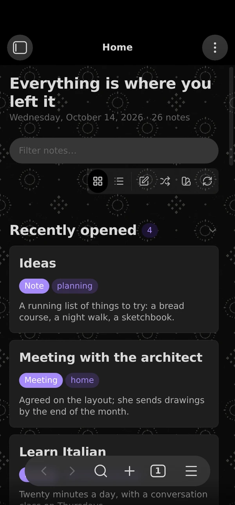

# Home Cards

Home Cards gives your vault a start page. The page shows sections of note cards: the notes you opened or created most recently, notes with a given property or tag, and the notes other notes link to most and least. Your theme sets the colors, fonts and spacing. You can add a background pattern and pick a card style in settings.


## Features

- **Sections.** Recently opened, created or modified; notes by property (with an optional value) or by tag; most and least linked; and Rediscover, a daily sample of notes untouched for months. Each section sets its own card count, sort order, and filters on tags, properties and folders.
- **One note, one section.** By default, a note appears only in the first section that claims it, so the page does not repeat itself. Section order sets which section wins.
- **Cards.** Each card shows the note's title, its type and tags, its first sentence (or a `summary` property), and a footer with the value the section sorts on.
- **Header actions.** New note creates a note where Obsidian's settings put new notes. Rediscover opens a random note you haven't changed in months.
- **Card actions.** Right-click a card for Obsidian's file menu. Hold Cmd or Ctrl over a card for a preview, through the Page Preview core plugin.
- **Fold and see more.** Click a section heading to fold it; the chevron at its end shows the state, and the page remembers it. "See more" under a section shows further matches, one section's worth at a time, up to three times; "Show fewer" puts them back.
- **Two layouts.** A grid of cards and a compact list of rows, switched from the header.
- **Background patterns.** Thirteen tiled patterns, each with a light and a dark version that follows the theme. Pick one in settings or from the swatch button in the header, which applies it as you click.
- **A Bases view.** Any base can show its results as "Home cards", with one section per group.
- **A greeting.** About 180 built-in greetings follow your local time of day, the day of the week and, optionally, fixed-date holidays, some in other languages, always in Latin script. On a Mac with Apple Intelligence, the on-device model can write a fresh one instead.


## Quick start

1. Install and enable Home Cards, then click the grid icon in the ribbon, or run **Home Cards: Open** from the command palette.
2. The first page shows four sections that work in any vault: recently opened, recently created, most linked and least linked.
3. To add a section for your own notes, open **Settings → Home Cards**, press **+** next to **Sections**, and set the source to **By property** or **By tag**.
4. If your notes record their kind in a property other than `type`, set **Cards → Type property** to that property.
5. Turn on **Open on startup** to make Home Cards your start page.



## Installation

Search for **Home Cards** under **Settings → Community plugins → Browse**, then install and enable it.

To install a release by hand, copy `main.js`, `manifest.json` and `styles.css` from the [latest release](https://github.com/ttangents/obsidian-home-cards/releases/latest) into `<vault>/.obsidian/plugins/home-cards/`, then reload Obsidian and enable Home Cards.

Home Cards requires Obsidian 1.13.1 or later and works on desktop and mobile.

## Settings

Every setting appears in Obsidian's settings search.

- **General:** whether the home page opens at startup, the layout it opens in, whether a note may appear in more than one section, and how long a note must sit untouched before Rediscover offers it.
- **Sections:** the sections, in page order. Drag a row to reorder it, use its toggle to show or hide it, and press its pencil to edit its source, card count, filters and sort order.
- **Cards:** the corner glyph, the type label and the property it reads, tags, the opening sentence and its length, and file size.
- **Card text:** the summary property, and the openings and title prefixes Home Cards passes over.
- **Appearance:** minimum card width, card surface (Flat, Elevated or Frosted) and background pattern.
- **Header:** the greeting and your name, holiday greetings, Apple Intelligence, and the note count.

### Optional: Typify icons

If you use the [Typify](https://community.obsidian.md/plugins/typify) plugin, set **Cards → Glyph** to **Icon from Typify**. Home Cards then reads Typify's icon settings and shows the icon for each note's type. Home Cards only reads Typify's settings file, and only while this option is on. Without Typify, the option falls back to each note's initial letter.

### Optional: greetings from Apple Intelligence

On a Mac running macOS 26 or later with Apple Intelligence turned on, Home Cards can ask the on-device model for each greeting. The option is off until you turn it on under **Settings → Home Cards → Header**.

Obsidian plugins cannot call Apple's model directly, so Home Cards runs a shortcut you build once in the Shortcuts app:

1. Create a shortcut named **Home Cards Greeting**.
2. Add **Get Text from Input**, with Shortcut Input as its input.
3. Add **Use Model**. Choose **On-Device**, and set its prompt to the Text from the previous step.
4. Add **Stop and Output**, and set it to the model's Response.

Then press **Test** under the shortcut's name in settings. Home Cards writes the next greeting ahead of time, so the page does not wait for the model, and it falls back to the built-in greetings whenever the shortcut or the model is unavailable. Phones, tablets and other computers always use the built-in greetings.

## Commands

- **Home Cards: Open** shows the home page, opening it in a new tab if needed.
- **Home Cards: Recompose** redraws every open home page and Home cards base view.

## Privacy and access

Home Cards makes no network requests, sends no data anywhere, shows no ads and needs no account. It reads your notes' metadata and the first paragraph of each note it shows. On each device, it keeps the paths of the last 100 notes you opened, and which sections you folded, in Obsidian's local storage, outside your synced settings.

One option works with files outside your vault, and it is off by default. **Greetings from Apple Intelligence**, on a Mac only, writes the prompt to a new folder in your system's temporary directory, runs your shortcut through macOS's `/usr/bin/shortcuts` command, reads the reply from that folder, and deletes the folder. The prompt holds only the date, the time and the name of any fixed-date holiday; it contains nothing from your vault, and the on-device model does not send it off your Mac. Home Cards keeps the next greeting in Obsidian's local storage on that Mac.

With **Icon from Typify** on, Home Cards also reads the Typify plugin's settings file in your vault's configuration folder.

## Architecture

The source divides into five layers. Each imports only from the layers above it; the views and settings tab also hold a type-only reference to the plugin class.

| Layer | Directory | Responsibility |
| --- | --- | --- |
| Settings | `src/settings/` | The schema, defaults and choice registries (`schema.ts`), and the normalizer that turns untrusted `data.json` into valid settings (`normalize.ts`). No imports from Obsidian. |
| Compose | `src/compose/` | Ranking, filtering, text extraction, the card model, the dek cache and the open history. Type-only imports from Obsidian; no DOM. |
| Platform | `src/platform/` | The greeting source and the macOS Shortcuts bridge for Apple Intelligence. |
| Render | `src/render/` | The home page view, the Bases view, the card DOM they share, and the card actions. |
| Settings tab | `src/settings-tab/` | The settings tab, declared through Obsidian's settings definitions, and the section editor. |

`src/main.ts` wires the layers together and owns persistence. Settings edits go through two methods: `touch()` records an edit and writes once edits stop, for keystrokes and sliders; `commit()` writes at once, for structural changes. After a write, the plugin fires a refresh event; each open view subscribes to it and redraws.

Each compose takes one snapshot of the vault: one file listing and at most one pass over the link table, shared by every section.

The test suite enforces the layering: it bundles the tested code with `obsidian` marked external, and the `obsidian` package ships no runtime code, so a runtime import in `settings/` or `compose/` fails to load. A separate test checks each layer's imports.

### Styles

`styles.css` is generated. Edit the partials in `styles/`, which `scripts/build-css.mjs` concatenates in filename order. Background tiles live in `assets/tiles/` as WebP files, each a seamless repeat 800px wide that the page draws at 400 CSS pixels under a per-tile veil of the theme background (the `--hc-veil-<id>` variables in `styles/10-backgrounds.css`); the build inlines them as data URLs, because Obsidian loads a plugin's stylesheet with no asset path. The build refuses to write a stylesheet with unbalanced braces or a placeholder that names a missing tile.

To add a background pattern, add `<id>-light.webp` and `<id>-dark.webp` to `assets/tiles/`, declare the two variables and one selector in `styles/10-backgrounds.css`, and add the entry to `BACKGROUNDS` in `src/settings/schema.ts`. The tests fail if any of the three is missing.

## Development

```sh
npm install
npm run build   # styles.css, type check, Obsidian's lint rules, main.js
npm test        # type-checks the tests, then runs them
npm run dev     # rebuilds main.js on save
```

`npm run lint` applies [Obsidian's review rules](https://github.com/obsidianmd/eslint-plugin), the checks the community directory runs on each release, to every file in the repository. See [RELEASING.md](RELEASING.md) for the release steps.

## License

[MIT](LICENSE)
