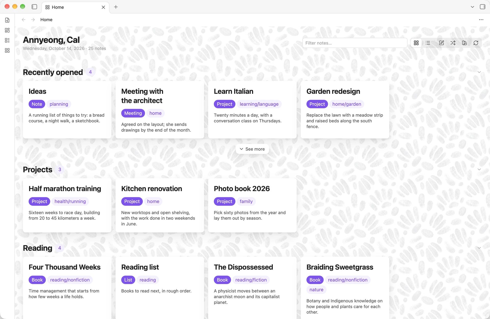
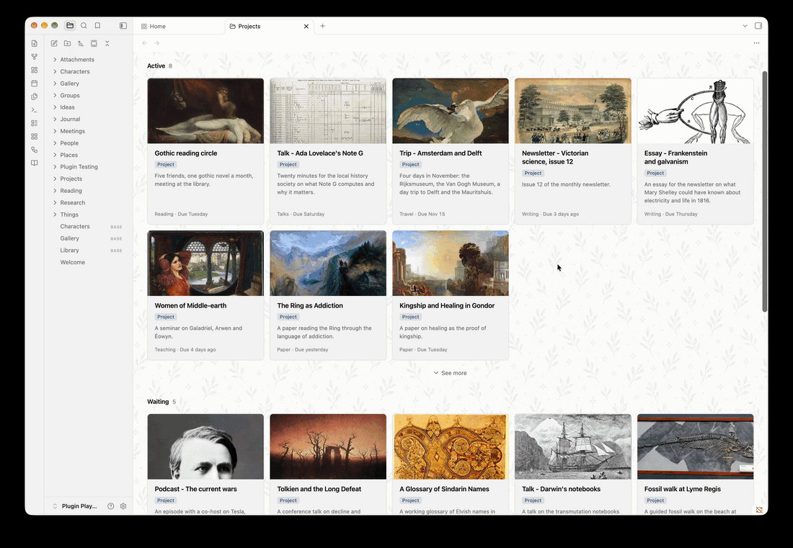
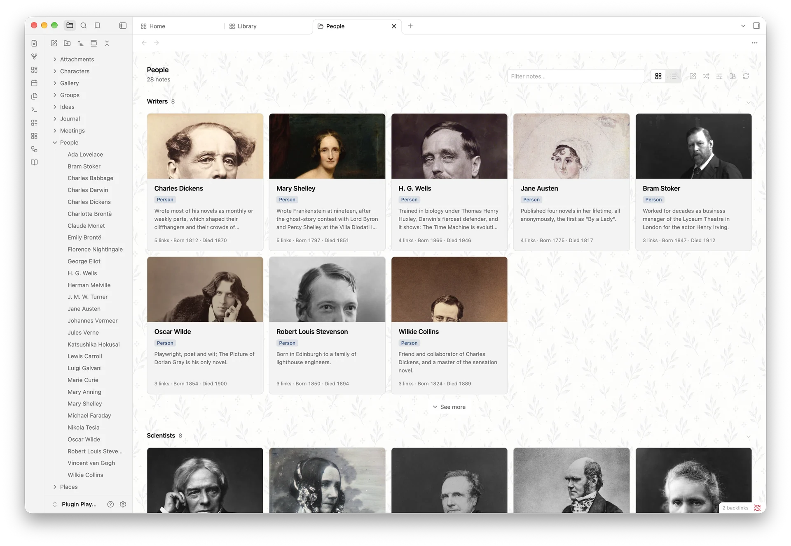
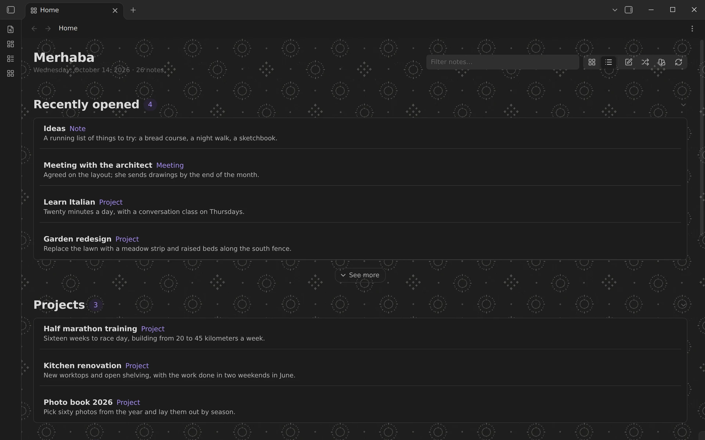

# Home Cards

Home Cards gives your vault a start page worth opening. It's a dashboard of note cards showing what you were in the middle of, what is due, notes related to today's work, and old notes you may have forgotten. Every card comes from your ordinary notes, their properties, tags and links, so a reading list, a project board or a people directory needs no special setup. Your theme supplies the colors, fonts and spacing, so Home Cards matches your vault from the start.



## Get started

1. Open Settings → Community plugins → Browse, search for Home Cards, then install it and turn it on.
2. Click the grid icon in the ribbon, or run "Home Cards: Open" from the command palette. Your first page already has four sections that suit any vault: recently opened, recently created, most linked and least linked.
3. Make it yours. In Settings → Home Cards, press + next to Sections and choose a source, such as notes with a property or a tag.
4. Want a page that follows your work? Add the Pinned, Continue working and Related to recent work sections, and give a section a condition such as "due is in the next 7 days".
5. Turn on "Open on startup", and Home Cards greets you every time you open Obsidian.

Home Cards works on desktop and mobile with Obsidian 1.13.1 or later.

## What you can do

- Pick up where you left off. Continue working shows the notes from your last work session, and each card says how it belongs, such as "Opened 43 minutes ago".
- See what is due. Conditions such as "due is today" or "rating is at least 4" turn any property into a section.
- Rediscover your vault. Six simple rules bring back forgotten notes, sleeping hubs, unfinished thoughts and notes from this week in earlier years, and every card tells you why it is there.
- Run a project board. Drag a card from Waiting to Active, and Home Cards sets the note's status for you.
- Give anything a page. A folder, a tag or a property can have a dashboard of its own, and every note has a page that shows what it links to and what links to it.
- Show any base as cards. Bases gains a Home cards view, with one section per group.
- Pin, snooze and pass over notes. Home Cards keeps these marks in its own settings and leaves your notes alone.
- Move around from the keyboard: / filters the cards, j and k move between them, and Enter opens one.





## Make it look your way

Switch between a grid of cards and a compact list of rows. Choose flat, elevated or frosted cards. Lay one of thirteen patterns behind your page, or add a picture of your own. A greeting changes with the time of day, and on holidays too if you like.

Theme authors and snippet fans get a set of documented style tokens. [Styling Home Cards](docs/STYLING.md) has the list, with recipes.



## Learn more

- [The Home Cards guide](docs/GUIDE.md) covers every section source, card, page, setting, command and link.
- [Styling Home Cards](docs/STYLING.md) is for CSS snippets, themes and the Style Settings plugin.
- [Home Cards for plugin developers](docs/API.md) shows how another plugin can use Home Cards' background patterns.

## Plays well with others

- [Relate](https://community.obsidian.md/plugins/relate), my plugin for two-way links between notes, adds sections for Relate searches, a section for each relationship on a note's page, and notes close in meaning to the ones you are working on.
- Pagewise, my plugin that shows notes as pages, gains an "Open Home Cards page" button on its toolbar, and it can paint Home Cards' backgrounds around its pages. Pagewise is on its way to Community plugins.
- With [Typify](https://community.obsidian.md/plugins/typify), set Cards → Glyph to "Icon from Typify" and each card shows the icon for its note's type.

You don't need any of these. Each one adds a little extra, and Home Cards works fully without them.

## Your privacy

Home Cards works entirely on your device. It never connects to the internet, sends no data anywhere, shows no ads and needs no account, and it reads no files outside your vault. It reads your notes' properties and the first paragraph of each note it shows. Card images come from your vault only.

On each device, Home Cards keeps a short memory in Obsidian's local storage, outside your synced settings:

- the last 100 notes you opened;
- when you opened notes in the last 30 days (up to 500 visits), and how often you opened each of up to 2,000 notes. Home Cards uses this for Continue working, Related to recent work and Old friends, and it follows renames and forgets deleted notes;
- which sections you folded;
- the newest release notes you have seen.

Pins, snoozes and passed-over notes live in Home Cards' settings file, so your notes stay untouched. Home Cards changes a note only when you ask it to, with + on a section, a drop, "Move to" or "Set a property…", and it makes the change through Obsidian. When you add a background image, Home Cards resizes it, strips its metadata (such as camera and location), and keeps the copy in a `backgrounds` folder inside its own plugin folder. Your original file stays where it was.

When Relate or Pagewise is running, Home Cards talks to it through the interface that plugin offers. Home Cards asks Relate for searches and relationships, adds one button to Pagewise's toolbar, and lends Pagewise its backgrounds.

## Install by hand

Copy `main.js`, `manifest.json` and `styles.css` from the [latest release](https://github.com/ttangents/obsidian-home-cards/releases/latest) into `<your vault>/.obsidian/plugins/home-cards/`, reload Obsidian, and turn Home Cards on.

## Build it yourself

```sh
npm install
npm run build   # styles.css and the tile module, type check, Obsidian's review rules, main.js
npm test        # type-checks the tests, then runs them with Vitest
npm run dev     # rebuilds main.js on save
```

`npm run lint` applies [Obsidian's review rules](https://github.com/obsidianmd/eslint-plugin), the same checks the community directory runs on each release.

The code uses only Obsidian's public API and treats your notes as the source of truth. It lives in four layers, and each one imports only from the layers above it:

| Layer | Folder | What it holds |
| --- | --- | --- |
| Settings | `src/settings/` | The settings schema and defaults, the normalizer that checks `data.json`, the store that decides when to save, and the rules for pages and added backgrounds |
| Compose | `src/compose/` | Choosing, ranking and describing cards, what a page shows, the activity log, and the connections to Relate and Pagewise. No DOM, and type-only imports from Obsidian |
| Render | `src/render/` | The home page and Bases views, cards and their actions, pickers, keyboard navigation and background storage |
| Settings tab | `src/settings-tab/` | The settings tab and the editors for sections, pages and backgrounds |

`src/main.ts` wires them together. `styles.css` and `src/render/tiles.generated.ts` are built from `styles/` and `assets/tiles/` by `scripts/build-css.mjs`, so neither is in the repository. To add a background pattern, add `<id>-light.webp` and `<id>-dark.webp` to `assets/tiles/`, give it veils and a selector in `styles/10-backgrounds.css`, and add it to `BACKGROUNDS` and `PATTERN_VEILS` in `src/settings/schema.ts`. The tests tell you if anything is missing.

## License

[MIT](LICENSE)
