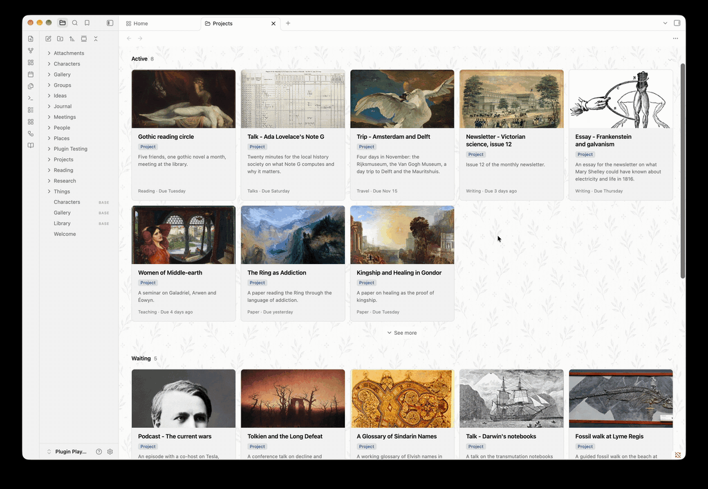
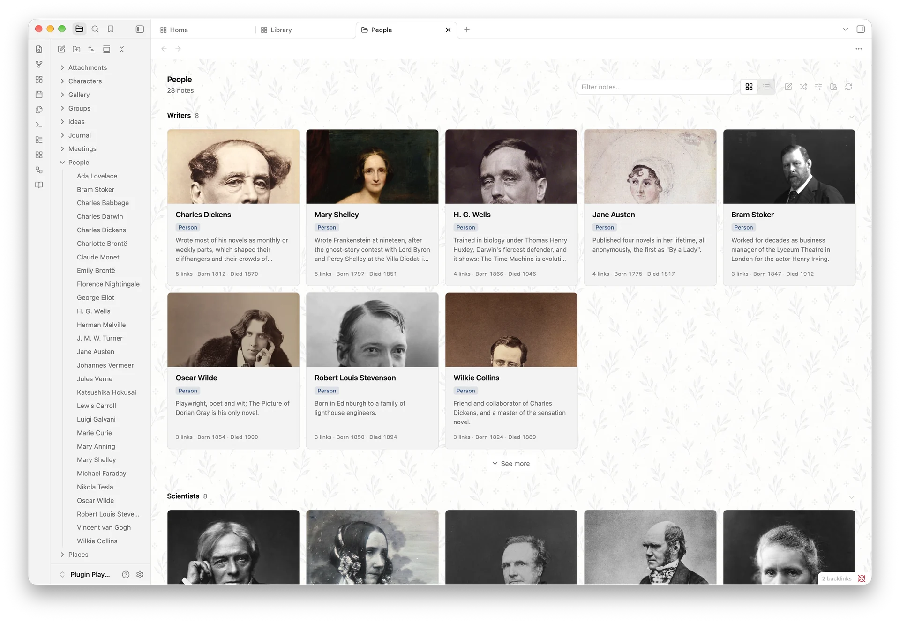
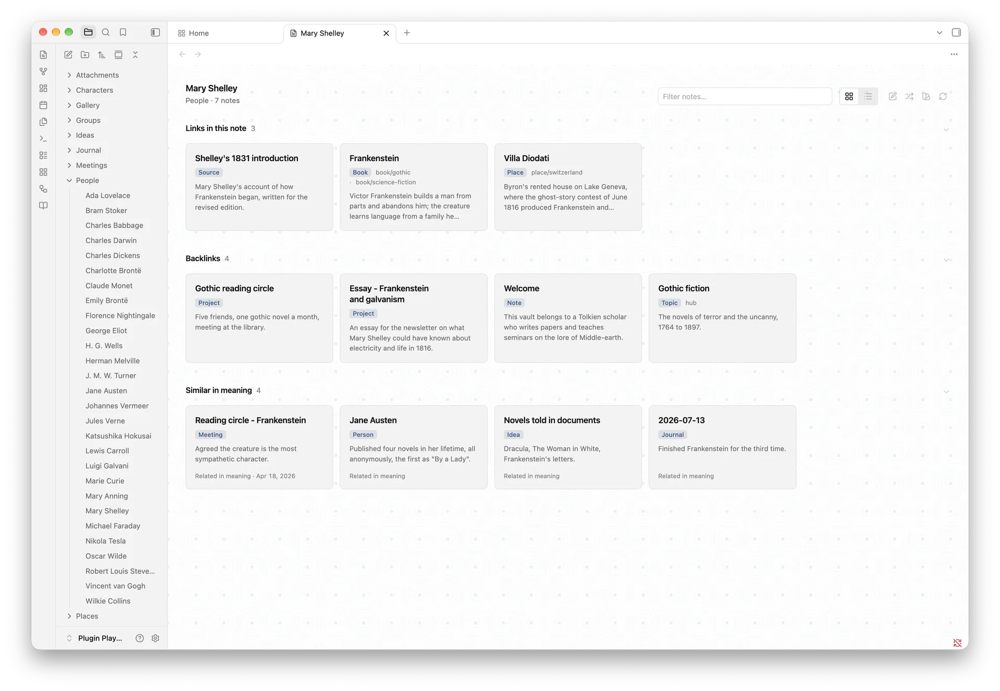
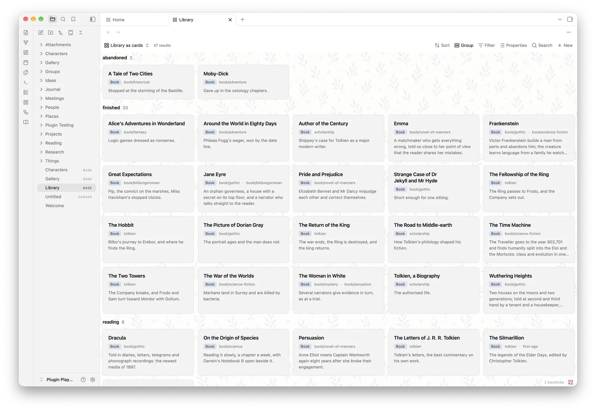
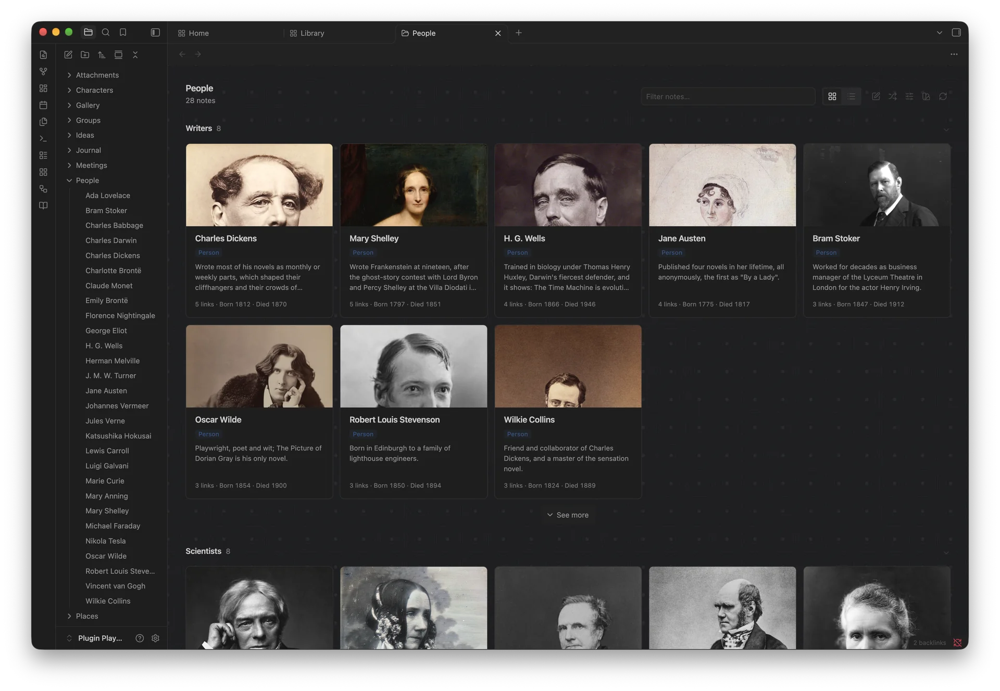
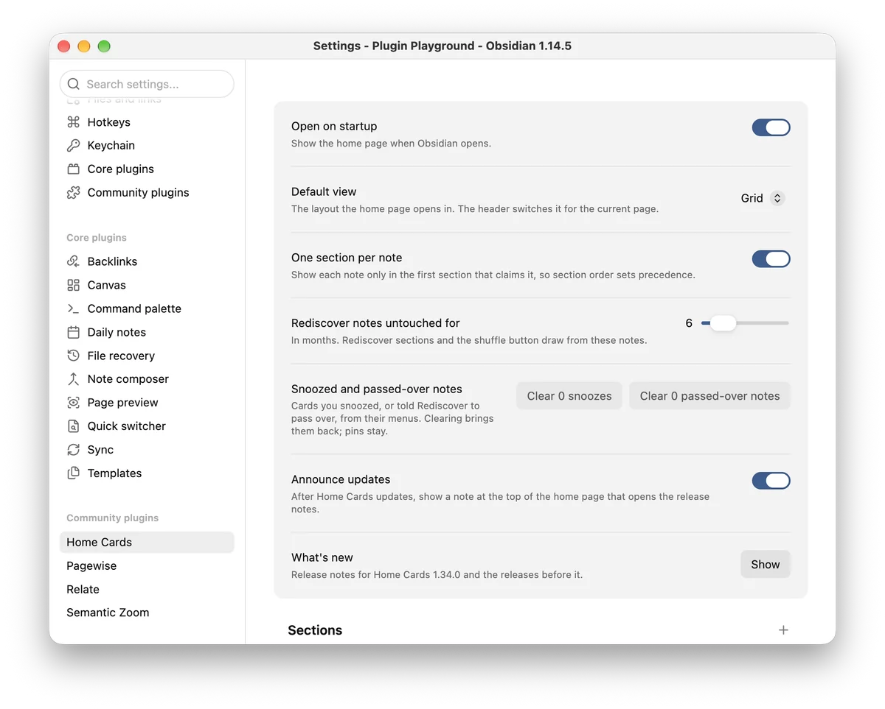

# Home Cards

Home Cards gives your Obsidian vault a start page: a dashboard of note cards that shows the work you were in the middle of, what is due, notes related to what you are doing, and notes you have drifted away from. Each section draws its cards from ordinary notes, their properties, tags and links, so a reading list, a project board or a people directory needs no special note types. A page gives a folder, a tag or a property a dashboard of its own, and any base can show its results as cards. Your theme sets the colors, fonts and spacing.


## Get started

1. Search for **Home Cards** under **Settings → Community plugins → Browse**, then install and enable it.
2. Click the grid icon in the ribbon, or run **Home Cards: Open** from the command palette. The first page shows four sections that work in any vault: recently opened, recently created, most linked and least linked.
3. To add a section for your own notes, open **Settings → Home Cards**, press **+** next to **Sections**, and set the source to **By property** or **By tag**.
4. For a page that follows your work, add sections with the sources **Pinned**, **Continue working** and **Related to recent work**, and give a section conditions such as "due is in the next 7 days".
5. If your notes record their kind in a property other than `type`, set **Cards → Type property** to that property.
6. Turn on **Open on startup** to make Home Cards your start page.

Home Cards requires Obsidian 1.13.1 or later and works on desktop and mobile. To install a release by hand, copy `main.js`, `manifest.json` and `styles.css` from the [latest release](https://github.com/ttangents/obsidian-home-cards/releases/latest) into `<vault>/.obsidian/plugins/home-cards/`, then reload Obsidian and enable Home Cards.

## What a page shows

A page is a list of sections, and each section is a set of cards with a source, optional filters and conditions, and a card count.

### Sections

- **Sources:** recently opened, created or modified; notes by property (with an optional value) or by tag; most and least linked; Pinned; Continue working; Related to recent work; and Rediscover.
- **Filters and conditions:** filters on tags, properties and folders, and typed conditions such as "due is today", "due is before today", "due is in the next 7 days", "rating is at least 4" or "modified is older than 90 days". A note must meet every condition.
- **One note, one section:** by default, a note appears only in the first section that claims it, so the page does not repeat itself. Section order sets which section wins.

**Continue working** shows the notes from your latest work session on this device, the notes you edited during it, then the session before. Opens with no gap longer than 45 minutes form one session. Each card says how it belongs, such as "Opened 43 minutes ago".

**Related to recent work** shows notes linked to what you opened most recently, or sharing links or tags with it. Each card names its strongest connection, such as "Linked from AWS notes" or "3 shared links with Vendor scorecard".

**Rediscover** has six strategies. Each is a plain rule, and each card says what chose it:

- Forgotten notes: untouched for months, in a new order each day.
- Forgotten gems: untouched but still linked to.
- Unfinished thoughts: short and barely linked.
- On this day: created or last edited in this week of an earlier year.
- Sleeping hubs: many links, long untouched.
- Old friends: opened often, not lately.

### Cards

Each card shows the note's title, its type and tags, its first sentence (or a `summary` property), and a footer. The footer says why the card is there, then shows up to three of the note's properties, such as "Active · Leslie · Due Friday" or "David Deutsch · Rating 5 · Reading".

A section can show a thumbnail or a cover on each card. Images come from the properties named in Settings (`cover, image` by default), or else the note's first embedded image, and only from your vault. A note without an image gets a tile with its initial, so the cards of a section line up.

Pages come in two layouts, a grid of cards and a compact list of rows, switched from the header. Rows show each section's images as small squares beside the title.


## Working from a page

### Create and move notes

A section that states exact values offers **+** in its heading to create a note with them: a property with a value ("type is Book"), a single tag, a single folder, or a condition such as "status is waiting". Drag a card onto such a section, or choose **Move to** in the card's menu, to give the note those values. A project board then needs only Active, Waiting and Done sections.



The section shows the change before you drop, and Home Cards makes it through Obsidian's own frontmatter editing. When the property holds a list, such as the projects a note belongs to, a card dropped from a section that states no value for it keeps its other values and gains the new one, and a card moved between two such sections swaps one value for the other. **Set a property…** in the card's menu sets any property.

### Pins and snooze

Pin a note to Home from its card's menu, any note menu in Obsidian, or the command palette. A Pinned section lists your pins, always comes first on its page, and stays hidden until you pin something. Snooze a card for a week or a month, or tell Rediscover to pass a note over. Home Cards keeps these marks in its own settings and leaves your notes unchanged.

### Keyboard

- <kbd>/</kbd> filters the cards.
- <kbd>j</kbd> and <kbd>k</kbd> or the arrow keys move between cards.
- <kbd>Enter</kbd> opens a card; with <kbd>Cmd</kbd> or <kbd>Ctrl</kbd> it opens in a new tab.
- <kbd>Space</kbd> previews a card.
- <kbd>p</kbd> pins or unpins a card.

### Menus and actions

- **Cards:** right-click a card for Obsidian's file menu and Home Cards' own actions. Hold Cmd or Ctrl over a card for a preview, through the Page Preview core plugin. A middle click opens a new tab.
- **Header:** New note creates a note where Obsidian's settings put new notes. Rediscover opens a random note you haven't changed in months.
- **Sections:** click a heading to fold its section; the chevron shows the state, and the page remembers it. "See more" under a section shows further matches, one section's worth at a time, up to three times; "Show fewer" puts them back.

## Pages

The home page is one page. You can make others, and every folder and every note has one.

### Pages for a folder, a tag or a property

A page shows the notes of one folder, one tag or one property, or of the whole vault, under the home page's sections or sections of its own. Make one with **Create a page** or in **Settings → Home Cards → Pages**. Each page opens in its own tab, from a command named for it (give it a hotkey in Obsidian's Hotkeys settings), from **Open a page**, or from a link such as `obsidian://home-cards?page=Reading`.

A folder needs no setup: right-click it and choose **Open Home Cards page**. A page about a folder follows the folder when you rename or move it, and the folder opens that page from its menu. **New note** on a tag or property page starts the note with that tag or property, so it appears on the page.



### A page for each note

Right-click a note and choose **Open Home Cards page**, or run **Open page for current note**, to see what the note links to and what links to it, as cards. Click the page's title to open the note.



### A Bases view

Any base can show its results as **Home cards**, with one section per group. A base takes any filter Bases offers, and it is a file in your vault; a Home Cards page is not.



## Appearance

- **Card surfaces:** Flat, Elevated or Frosted, in **Settings → Home Cards → Appearance**.
- **Background patterns:** thirteen tiled patterns, each with a light and a dark version that follows the theme. Pick one in settings or from the swatch button in the header, which applies it as you click.
- **Your own backgrounds:** add a PNG, JPEG, WebP or GIF from **Settings → Home Cards → Your backgrounds**, as a repeating pattern or a single picture, with a fade that sets how much of the theme's background covers it. Home Cards keeps a resized copy in its own plugin folder, so your vault gains no files or folders. Up to twelve images.
- **A greeting:** about 180 built-in greetings follow your local time of day, the day of the week and, optionally, fixed-date holidays, some in other languages, always in Latin script.

### Styling with CSS

Home Cards has a small, documented styling interface for CSS snippets, themes and the Style Settings plugin: public `--hc-*` tokens for spacing, cards, type and images, a few stable selectors and data attributes, and an optional CSS class on any page or section, under **Advanced** in its editor. [Styling Home Cards](docs/STYLING.md) lists them, with recipes, and explains what stays stable across releases. The People page above carries the class `portraits`, which a short snippet uses to give its covers a portrait shape.



## Works with other plugins

### Relate

Home Cards works well with [Relate](https://community.obsidian.md/plugins/relate), my other plugin, which links notes both ways and can search by meaning. Install it from **Settings → Community plugins → Browse**. You don't need it to use Home Cards. If you use both:

- A section can list the results of a Relate search, such as `notes of Q3 Plan this week`, and each card says why it is there, down to the chain of links that connects it.
- A note's page gives each of the note's relationships a section of its own, then lists the links no relationship covers, then the notes closest in meaning.
- **Related to recent work** names the relationship behind each card, such as "Q3 Plan's notes", and adds notes close in meaning to what you opened.
- **Rediscover** gains **Similar but unlinked**: notes close in meaning to the ones you opened most recently, with no link between them, that you have not opened lately.

These options appear only while Relate is running. If you turn Relate off, a section that uses it keeps its settings and says it needs Relate, and the rest of the page works as before.

### Pagewise

Home Cards also works with Pagewise, my other plugin, which shows notes as paginated sheets with a document toolbar. Pagewise is not in Community plugins yet. You don't need it to use Home Cards. If you use both:

- Pagewise's toolbar gains **Open Home Cards page**, which opens the page of the note you are reading, in either view mode.

The button appears only while Pagewise is running, and Pagewise's own toolbar settings can hide it. If you turn either plugin off, the button goes, and the rest of each plugin works as before.

### Typify

If you use the [Typify](https://community.obsidian.md/plugins/typify) plugin, set **Cards → Glyph** to **Icon from Typify**. Home Cards then reads Typify's icon settings and shows the icon for each note's type. Home Cards only reads Typify's settings file, and only while this option is on. Without Typify, the option falls back to each note's initial letter.

## Settings

Every setting appears in Obsidian's settings search.

- **General:** whether the home page opens at startup, the layout it opens in, whether a note may appear in more than one section, and how long a note must sit untouched before Rediscover offers it. General also clears snoozes and passed-over notes, turns update announcements on or off, and opens the release notes.
- **Sections:** the sections, in page order. Drag a row to reorder it, use its toggle to show or hide it, and press its pencil to edit its source, card count, filters, conditions, sort order, card fields and image.
- **Pages:** the pages you made. Each row opens the page or edits its name, what it is about, and whether it has sections of its own. A folder you never customized still opens a page, so it has no row here.
- **Cards:** the corner glyph, the type label and the property it reads, the image properties, tags, the opening sentence and its length, and file size.
- **Card text:** the summary property, and the openings and title prefixes Home Cards passes over.
- **Appearance:** minimum card width, card surface and background pattern.
- **Your backgrounds:** the images you added. Each has a name and a fade; deleting a row deletes its stored copy.
- **Header:** the greeting and your name, holiday greetings, and the note count.

After an update, a line at the top of the home page names the new version and opens its release notes. Close it, or read the notes, and it goes away on every device that syncs your settings. **Settings → Home Cards → What's new** shows the notes for recent releases at any time, and **Announce updates** turns the line off.



## Commands and links

- **Home Cards: Open** shows the home page, opening it in a new tab if needed.
- **Home Cards: Recompose** redraws every open home page and Home cards base view.
- **Home Cards: Open page for current folder** opens the page for the folder of the note you are reading. It appears when that note sits in a folder.
- **Home Cards: Open page for a folder** lists every folder and opens the one you choose.
- **Home Cards: Open page for current note** opens a page of what the note you are reading links to and what links to it. **Open Home Cards page** in a note's menu does the same.
- **Home Cards: Open a page** lists the home page and your pages, and opens the one you choose.
- **Home Cards: Create a page** opens the page editor, then the new page.
- **Home Cards: Open [name] page** exists for each page you made, and takes a hotkey.
- **Home Cards: Pin or unpin the current note** pins the note you are reading to Home.
- **Home Cards: Show what's new** opens the release notes.

`obsidian://home-cards` opens the home page. `obsidian://home-cards?page=Reading` opens the page named Reading, `obsidian://home-cards?folder=Projects/Clients` opens a folder's page, and `obsidian://home-cards?note=Atlas` opens a note's page. A link that names a page, folder or note that does not exist shows a notice and does nothing else.

## Privacy and access

Home Cards makes no network requests, works with no files outside your vault, sends no data anywhere, shows no ads and needs no account. It reads your notes' metadata and the first paragraph of each note it shows. Card images come only from your vault; Home Cards passes over a property that holds a web address.

On each device, Home Cards keeps four things in Obsidian's local storage, outside your synced settings:

- the paths of the last 100 notes you opened;
- a log of when you opened notes over the last 30 days, at most 500 entries, with a visit count for up to 2,000 notes; Continue working, Related to recent work and Old friends read this log, and the log follows renames and forgets deleted notes;
- which sections you folded;
- the newest release whose notes you have seen, so an older settings file arriving by sync cannot announce it again.

Pins, snoozes and passed-over notes sit in Home Cards' settings file, never in your notes, as does the newest release you have seen announced. The release notes ship inside the plugin; the What's new window loads nothing from the web, and its one link opens the releases page in your browser. Home Cards changes a note only when you ask it to, with + on a section, a drop, **Move to** or **Set a property…**, and it makes the change through Obsidian.

When you add a background image, Home Cards decodes it, scales it down, and saves a copy without its metadata (such as camera and location) in a `backgrounds` folder inside its own plugin folder. It creates that folder with the first image and removes it with the last. Your original file stays where it is, and your vault's notes and attachments stay untouched.

With **Icon from Typify** on, Home Cards also reads the Typify plugin's settings file in your vault's configuration folder.

When the Relate plugin is running, Home Cards asks it for searches, relationships and similar notes through the interface Relate offers to other plugins. Home Cards itself sends nothing anywhere. When the Pagewise plugin is running, Home Cards adds one button to its toolbar through the interface Pagewise offers to other plugins. If you set Relate to use your own embedding server, Relate sends the text of your searches and notes to that server.

## Development

```sh
npm install
npm run build   # styles.css and the tile module, type check, Obsidian's lint rules, main.js
npm test        # type-checks the tests, then runs them with Vitest
npm run dev     # rebuilds main.js on save
```

`npm run lint` applies [Obsidian's review rules](https://github.com/obsidianmd/eslint-plugin), the checks the community directory runs on each release, to every file in the repository. Pushing a version tag runs `.github/workflows/release.yml`, which builds, tests and attests the release files and drafts the GitHub release.

The code calls only Obsidian's public API, treats the vault's notes as the source of truth, and keeps Home Cards' own state, such as pins and the activity log, apart from facts about notes. The source divides into four layers. Each imports only from the layers above it, and none imports the plugin class.

| Layer | Directory | Responsibility |
| --- | --- | --- |
| Settings | `src/settings/` | The schema, defaults and choice registries (`schema.ts`), the normalizer that turns untrusted `data.json` into valid settings (`normalize.ts`), the settings store that decides when edits are written and when synced settings replace them (`store.ts`), the folder path rules (`folders.ts`), the rules for named pages (`pages.ts`) and the custom-background rules (`custom-background.ts`). No imports from Obsidian. |
| Compose | `src/compose/` | The domain: selection (filters and typed conditions), ranking, Rediscover strategies, sessions, related-note scoring, the card model and its fields and images, what a page shows (`plan.ts`), marks, note templates, the activity log, the dek cache, the open history, and the handshake with Relate and Pagewise (`partner.ts`). A compose can be limited to a page's scope: a folder, a tag or a property. Type-only imports from Obsidian; no DOM. |
| Render | `src/render/` | The home page view (which also draws every other page), the Bases view, the card DOM they share, the card actions and note changes, the page and property pickers, keyboard navigation, the release notice, the storage of added background images, and the legacy Typify icon reader. |
| Settings tab | `src/settings-tab/` | The settings tab, declared through Obsidian's settings definitions, the editors it opens (sections and their conditions, pages and backgrounds), and the page service that opens, creates and edits pages. |

`src/main.ts` is the composition root: it builds the services and hands each view and editor the narrow part it needs. Settings edits go through the store's two methods: `touch()` records an edit and writes once edits stop, for keystrokes and sliders; `commit()` writes at once, for structural changes. After a write, the plugin fires a refresh event; each open view subscribes to it and redraws.

Each compose takes one snapshot of the vault: one file listing and at most one pass over the link table, shared by every section.

The test suite enforces the layering: Vitest loads the tested code in Node, and the `obsidian` package ships no runtime code, so a runtime import in `settings/` or `compose/` fails to load. A separate test checks each layer's imports.

### Styles

`styles.css` is generated, and so is `src/render/tiles.generated.ts`; neither is in the repository. Edit the partials in `styles/`, which `scripts/build-css.mjs` concatenates in filename order. Background tiles live in `assets/tiles/` as WebP files, each a seamless repeat 800px wide that the page draws at 400 CSS pixels under a per-tile veil of the theme background (the `--_hc-veil-<id>` variables in `styles/10-backgrounds.css`). Obsidian parses a plugin's stylesheet in every window at load, so the tiles stay out of it: the build writes them as data URLs into the tile module, esbuild bundles that into `main.js`, and the page sets only the chosen pattern's tiles as custom properties. The build refuses to write a stylesheet with unbalanced braces or an embedded image, and a pattern without both tiles. The tests hold `styles.css` to 150 KB.

To add a background pattern, add `<id>-light.webp` and `<id>-dark.webp` to `assets/tiles/`, declare its two veil variables and one selector in `styles/10-backgrounds.css`, and add the entry to `BACKGROUNDS` in `src/settings/schema.ts`. The tests fail if any of these is missing.

Custom properties named `--hc-*` are the public styling contract in [docs/STYLING.md](docs/STYLING.md); Home Cards reads them and never declares them. Its own defaults and plumbing use `--_hc-*`. The tests fail if the styles read a public token the guide does not document, or declare one outside the Style Settings layer in `styles/95-style-settings.css`.

## License

[MIT](LICENSE)
