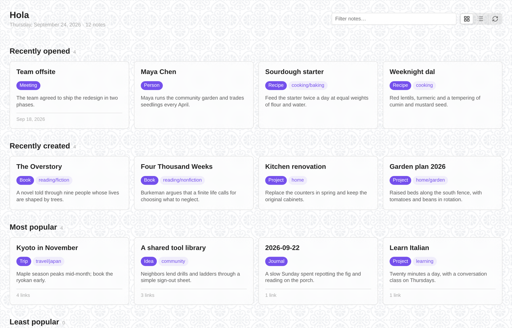
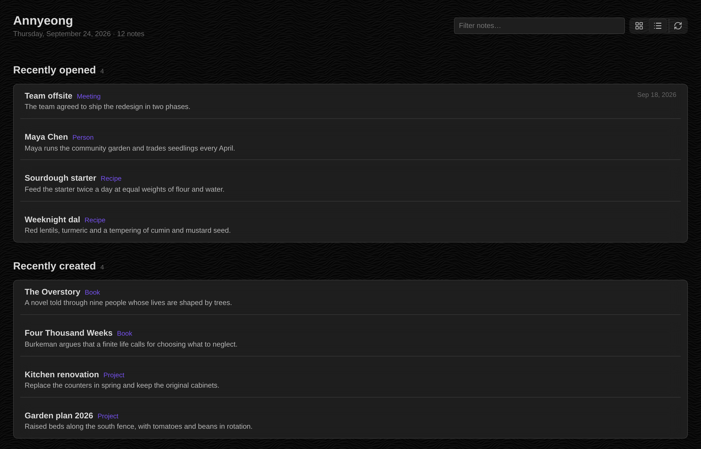
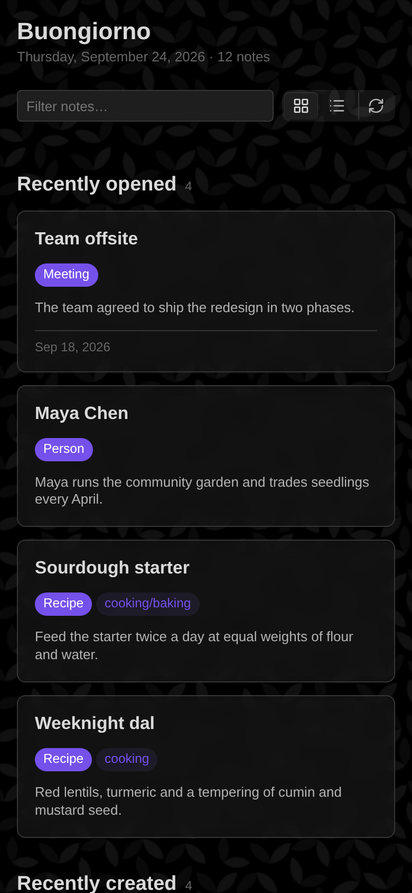

# Home Cards

Home Cards gives your vault a start page. The page shows sections of note cards: the notes you opened or created most recently, notes with a given property or tag, and the notes other notes link to most and least. Your theme sets the colors, fonts and spacing. You can add a background pattern and pick a card style in settings.



## Features

- **Sections.** Recently opened, created or modified; notes by property (with an optional value) or by tag; most and least linked. Each section sets its own card count, sort order, and filters on tags, properties and folders.
- **One note, one section.** By default, a note appears only in the first section that claims it, so the page does not repeat itself. Section order sets which section wins.
- **Cards.** Each card shows the note's title, its type and tags, its first sentence (or a `summary` property), and a footer with the value the section sorts on.
- **Two layouts.** A grid of cards and a compact list of rows, switched from the header.
- **A Bases view.** Any base can show its results as "Home cards", with one section per group.
- **A greeting.** The greeting follows your local time of day and, optionally, fixed-date holidays. Now and then it greets you in another language, always in Latin script.



## Quick start

1. Install and enable Home Cards, then click the grid icon in the ribbon, or run **Home Cards: Open** from the command palette.
2. The first page shows four sections that work in any vault: recently opened, recently created, most linked and least linked.
3. To add a section for your own notes, open **Settings → Home Cards → Sections**, choose **Add section**, and set the source to **By property** or **By tag**.
4. If your notes record their kind in a property other than `type`, set **Settings → Home Cards → Cards → Type label** to that property.
5. Turn on **Open on startup** under **Layout → Header** to make Home Cards your start page.



## Installation

Until Home Cards is listed in the community directory, install it with [BRAT](https://github.com/TfTHacker/obsidian42-brat):

1. Install and enable BRAT from **Settings → Community plugins**.
2. Run **BRAT: Add a beta plugin for testing** and enter `GITHUB_USER/home-cards`.
3. Enable Home Cards under **Settings → Community plugins**.

To install by hand, copy `main.js`, `manifest.json` and `styles.css` from the latest release into `<vault>/.obsidian/plugins/home-cards/`, then reload Obsidian.

Home Cards requires Obsidian 1.10 or later and works on desktop and mobile.

## Settings

- **Sections:** the list of sections, in page order, and whether a note may appear in more than one.
- **Cards:** the corner glyph, the type label and its property, tags, the first sentence and its length, file size, and how Home Cards cleans titles and picks sentences.
- **Layout:** the default view, minimum card width, card surface, background pattern, greeting, note count, and whether Home Cards opens at startup.

### Optional: Typify icons

If you use the [Typify](https://community.obsidian.md/plugins/typify) plugin, set **Cards → Glyph** to **Icon from Typify**. Home Cards then reads Typify's icon settings and shows the icon for each note's type. Home Cards only reads Typify's settings file, and only while this option is on. Without Typify, the option falls back to each note's initial letter.

## Commands

- **Home Cards: Open** shows the home page, opening it in a new tab if needed.
- **Home Cards: Recompose** redraws every open home page and Home cards base view.

## Privacy

Home Cards makes no network requests and sends no data anywhere. It reads your notes' metadata and the first paragraph of each note it shows.

## Architecture

The source divides into four layers. Each imports only from the layers above it; the views and settings tab also hold a type-only reference to the plugin class.

| Layer | Directory | Responsibility |
| --- | --- | --- |
| Settings | `src/settings/` | The schema, defaults and choice registries (`schema.ts`), and the normalizer that turns untrusted `data.json` into valid settings (`normalize.ts`). No imports from Obsidian. |
| Compose | `src/compose/` | Ranking, filtering, text extraction, the card model and the dek cache. Type-only imports from Obsidian; no DOM. |
| Render | `src/render/` | The home page view, the Bases view, and the card DOM they share. |
| Settings tab | `src/settings-tab/` | The settings UI, built from the schema's registries. |

`src/main.ts` wires the layers together and owns persistence. Settings edits go through two methods: `touch()` records an edit and writes once edits stop, for keystrokes and sliders; `commit()` writes at once, for structural changes. After a write, the plugin fires a refresh event; each open view subscribes to it and redraws.

Each compose takes one snapshot of the vault: one file listing and at most one pass over the link table, shared by every section.

The test suite enforces the layering: it bundles the tested code with `obsidian` marked external, and the `obsidian` package ships no runtime code, so a runtime import in `settings/` or `compose/` fails to load. A separate test checks each layer's imports.

### Styles

`styles.css` is generated. Edit the partials in `styles/`, which `scripts/build-css.mjs` concatenates in filename order. Background tiles live in `assets/tiles/` as WebP files, each a seamless repeat 800px wide that the page draws at 400 CSS pixels under a veil of the theme background (`--hc-veil` in `styles/10-backgrounds.css`); the build inlines them as data URLs, because Obsidian loads a plugin's stylesheet with no asset path. The build refuses to write a stylesheet with unbalanced braces or a placeholder that names a missing tile.

To add a background pattern, add `<id>-light.webp` and `<id>-dark.webp` to `assets/tiles/`, declare the two variables and one selector in `styles/10-backgrounds.css`, and add the entry to `BACKGROUNDS` in `src/settings/schema.ts`. The tests fail if any of the three is missing.

## Development

```sh
npm install
npm run build   # styles.css, type check, Obsidian's lint rules, main.js
npm test        # type-checks the tests, then runs them
npm run dev     # rebuilds main.js on save
```

`npm run lint` applies [Obsidian's review rules](https://github.com/obsidianmd/eslint-plugin), the same checks the community directory runs on each release. See [RELEASING.md](RELEASING.md) for the release steps.

## License

[MIT](LICENSE)
