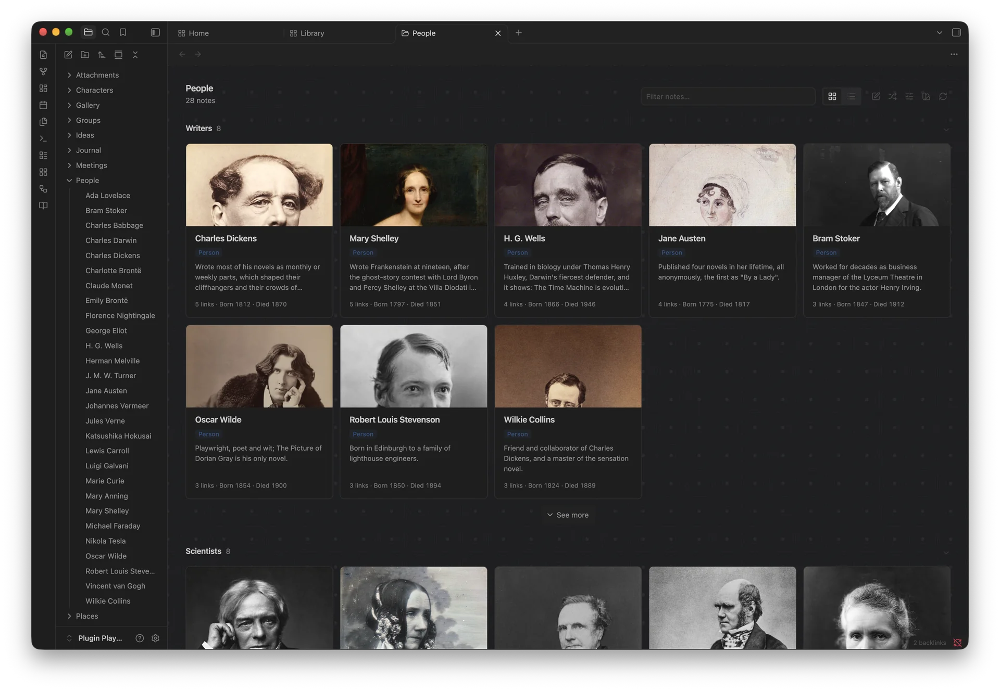
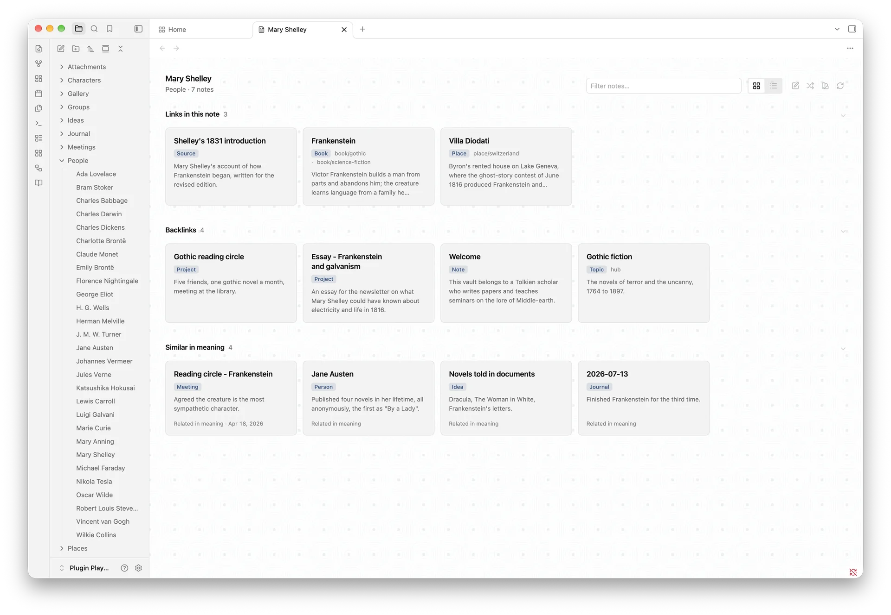
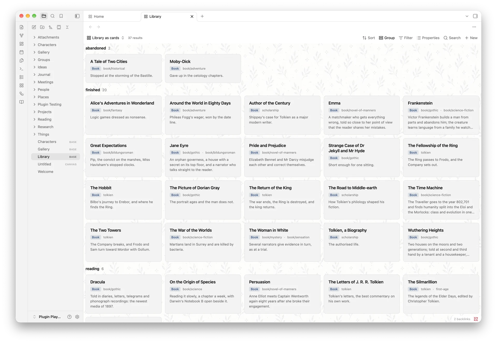
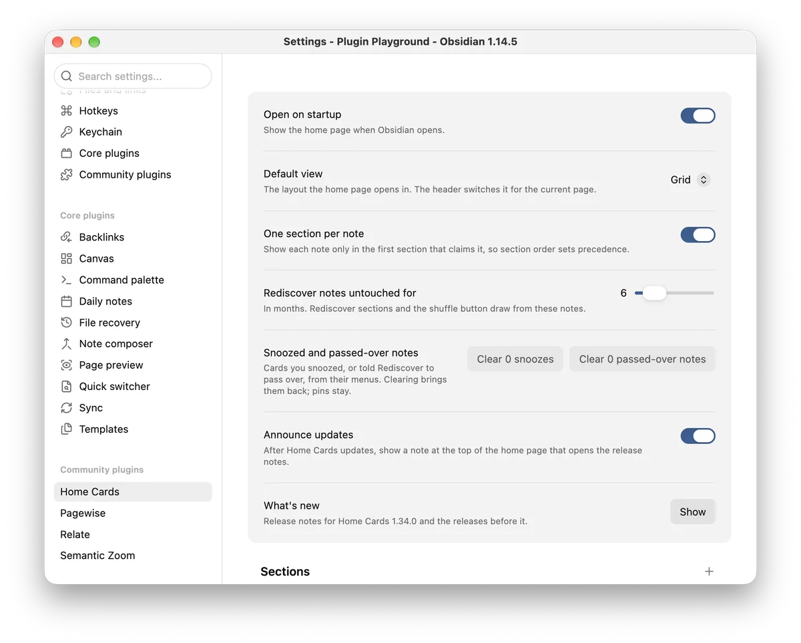

# The Home Cards guide

This guide walks through everything Home Cards can do, from the sections on a page to the commands and links that open them. New here? The [README](../README.md) gets you started in five steps.

## Pages, sections and cards

A page is a list of sections, and each section is a set of cards. You decide where a section's cards come from, which notes it keeps, and how many cards it shows. The home page is one page. You can make as many others as you like.

### Where cards come from

Each section has a source:

- recently opened, created or modified notes;
- notes with a property, optionally with a set value, or notes with a tag;
- the most linked and the least linked notes;
- Pinned, Continue working, Related to recent work and Rediscover, described below.

### Narrow it down

Filters keep notes with certain tags, properties or folders. Conditions read a property's value, such as "due is today", "due is before today", "due is in the next 7 days", "rating is at least 4" or "modified is older than 90 days". A note has to meet every condition to appear.

By default, a note shows up only in the first section that claims it, so your page never repeats itself. The order of your sections decides which one wins. You can turn this off in Settings → Home Cards → General.

### Continue working

Continue working gathers the notes from your latest work session on this device: the ones you opened, then the ones you edited, then the session before. Home Cards counts notes you open less than 45 minutes apart as one session. Each card says how it belongs, such as "Opened 43 minutes ago".

### Related to recent work

This section finds notes linked to what you opened most recently, or sharing links or tags with it. Each card names its strongest connection, such as "Linked from AWS notes" or "3 shared links with Vendor scorecard".

### Rediscover

Rediscover brings back notes you may have lost track of. Choose one of six rules, and each card tells you which one picked it:

- Forgotten notes: untouched for months, in a fresh order each day.
- Forgotten gems: untouched, but other notes still link to them.
- Unfinished thoughts: short and barely linked.
- On this day: created or last edited in this week of an earlier year.
- Sleeping hubs: plenty of links, long untouched.
- Old friends: notes you opened often, but not lately.

You decide how long a note sits untouched before Rediscover offers it, in Settings → Home Cards → General.

### What a card shows

A card shows the note's title, its type and tags, its first sentence (or its `summary` property), and a footer. The footer starts with why the card is there, then shows up to three of the note's properties, such as "Active · Priya · Due Friday" or "David Deutsch · Rating 5 · Reading".

A section can add a thumbnail or a cover to each card. Home Cards takes the image from the properties named in Settings (`cover, image` by default), or else from the first image the note embeds, and only from your vault. A note without an image gets a tile with its initial, so the cards in a section line up neatly.

Pages come in two layouts, a grid of cards and a compact list of rows. Switch between them from the page header. In rows, each section's images become small squares beside the titles.

## Working from a page

### Create and move notes

When a section states exact values, its heading offers a + button that creates a note with them. That works for a property with a value ("type is Book"), a single tag, a single folder, or a condition such as "status is waiting".

Drag a card onto such a section, or choose "Move to" in the card's menu, and Home Cards gives the note those values. So a project board needs only three sections: Active, Waiting and Done. The section shows the change before you drop, and Home Cards makes it through Obsidian's own property editing.

List properties get special care. Say a note belongs to several projects. Drag its card from a section that sets no project into a project section, and the note keeps its other projects and gains the new one. Move it between two project sections, and Home Cards swaps one project for the other.

"Set a property…" in a card's menu sets any property you like.

### Pins and snooze

Pin a note to Home from its card's menu, from any note menu in Obsidian, or from the command palette. A Pinned section lists your pins, always comes first on its page, and stays hidden until you pin something.

Snooze a card for a week or a month, or tell Rediscover to pass a note over. Home Cards keeps all these marks in its own settings, so your notes stay exactly as they are.

### Keyboard

| Key | What it does |
|---|---|
| / | Filters the cards |
| j and k, or the arrow keys | Move between cards |
| Enter | Opens a card. Add Cmd or Ctrl to open it in a new tab |
| Space | Previews a card |
| p | Pins or unpins a card |

### Menus and actions

- Right-click a card for Obsidian's file menu plus Home Cards' own actions.
- Hold Cmd or Ctrl over a card to preview it, through the Page Preview core plugin. A middle click opens it in a new tab.
- In the header, New note creates a note wherever Obsidian's settings put new notes. Rediscover opens a random note you haven't changed in months. Pages opens the page picker, so you can jump to any other page.
- Click a section's heading to fold it, and the page remembers. "See more" under a section shows another section's worth of matches, up to three times. "Show fewer" puts them back.

## More pages

### A page for a folder, a tag or a property

A page can show the notes of one folder, one tag or one property, or of the whole vault. It can use the home page's sections or have sections of its own. Make one with "Create a page" or in Settings → Home Cards → Pages.

Each page opens in its own tab. Open it from the Pages button in any page's header, from "Open a page", from a command named after it (give it a hotkey in Obsidian's Hotkeys settings), or from a link such as `obsidian://home-cards?page=Reading`.

Every folder already has a page, with no setup at all. Right-click the folder and choose "Open Home Cards page". A page about a folder follows the folder when you rename or move it. On a tag or property page, New note starts the note with that tag or property, so it lands right on the page.

If a folder page and a page you named share a name, the folder page's title gains "(folder)", so you can tell them apart.

### A page for each note

Right-click a note and choose "Open Home Cards page", or run "Open page for current note". You get cards for everything the note links to and everything that links to it. Click the page's title to open the note itself.

### Home cards in Bases

Any base can show its results as Home cards, with one section per group. A base can use any filter Bases offers, and because a base is a file in your vault, you can link to it, embed it and sync it like any note.

## Appearance

- Card surfaces: Flat, Elevated or Frosted, in Settings → Home Cards → Appearance.
- Background patterns: thirteen tiled patterns, each with a light and a dark version that follows your theme. Pick one in settings, or from the swatch button in the header, which shows it as you click.
- Your own backgrounds: add a PNG, JPEG, WebP or GIF in Settings → Home Cards → Your backgrounds, as a repeating pattern or a single picture. A fade sets how much of your theme's background covers it. Home Cards keeps a resized copy in its own plugin folder, so your note folders gain no new files. You can keep up to twelve.
- A greeting: about 180 greetings that follow your local time of day and the day of the week, plus holiday greetings if you turn them on. A few are in other languages, always in Latin script.

For CSS snippets, themes and Style Settings, see [Styling Home Cards](STYLING.md).

## Plays well with others

### Relate

[Relate](https://community.obsidian.md/plugins/relate), my plugin for two-way links between notes, opens up some extra tricks while it runs:

- A section can list the results of a Relate search, such as `notes of Q3 Plan this week`. Each card says why it is there, down to the chain of links that connects it.
- A note's page gives each of the note's relationships a section of its own, then lists the links no relationship covers, then the notes closest in meaning.
- Related to recent work names the relationship behind each card, such as "Q3 Plan's notes", and adds notes close in meaning to what you opened.
- Rediscover gains Similar but unlinked: notes close in meaning to the ones you opened most recently, with no link between them, that you haven't opened lately.

If you turn Relate off, a section that uses it keeps its settings and tells you it needs Relate. The rest of the page works as before.

### Pagewise

Pagewise, my plugin that shows notes as pages, gets two extras when both plugins run:

- Its toolbar gains "Open Home Cards page", which opens the page of the note you are reading, in either view mode.
- Its Background button offers Home Cards' patterns and the images you added in Home Cards, painted a little fainter around its pages.

Turn either plugin off, and these extras step aside while both plugins keep working as usual.

### Typify

With the [Typify](https://community.obsidian.md/plugins/typify) plugin, set Cards → Glyph to "Icon from Typify", and each card shows the icon for its note's type. Home Cards reads Typify's settings file only while this option is on. Without Typify, the glyph falls back to each note's initial.

## Settings

You can find every setting with Obsidian's settings search.

- General: whether the home page opens at startup, the layout it opens in, whether a note may appear in more than one section, and how long a note sits untouched before Rediscover offers it. This is also where you clear snoozes and passed-over notes, turn update announcements on or off, and open What's new.
- Sections: your sections, in page order. Drag a row to move it, flip its toggle to show or hide it, and press its pencil to edit its source, card count, filters, conditions, sort order, card fields and image.
- Pages: the pages you made. Each row opens its page, or edits its name, what it is about, and whether it has sections of its own. Every folder has a page already, and a folder gets a row here only after you customize its page.
- Cards: the corner glyph, the type label and the property it reads, the image properties, tags, the opening sentence and its length, and file size.
- Card text: the summary property, and the opening phrases and title prefixes Home Cards skips when it picks a card's first sentence.
- Appearance: minimum card width, card surface and background pattern.
- Your backgrounds: the images you added, each with a name and a fade. Deleting a row deletes its stored copy too.
- Header: the greeting and your name, holiday greetings, and the note count.

After an update, a line at the top of the home page names the new version and opens its release notes. Close it, or read the notes, and it goes away on every device that syncs your settings. What's new, under General, shows recent release notes at any time, and "Announce updates" turns the line off.

## Commands

| Command | What it does |
|---|---|
| Home Cards: Open | Shows the home page, in a new tab if needed |
| Home Cards: Recompose | Redraws every open home page and Home cards view |
| Home Cards: Open page for current folder | Opens the page for the folder of the note you are reading |
| Home Cards: Open page for a folder | Lists your folders and opens the one you pick |
| Home Cards: Open page for current note | Opens the note's page of links and backlinks |
| Home Cards: Open a page | Lists the home page and your pages, and opens the one you pick |
| Home Cards: Create a page | Opens the page editor, then your new page |
| Home Cards: Open [name] page | One for each page you made, ready for a hotkey |
| Home Cards: Pin or unpin the current note | Pins the note you are reading to Home, or unpins it |
| Home Cards: Show what's new | Opens the release notes |

## Links from anywhere

Open Home Cards from a note, a Shortcut or a launcher with these links:

| Link | Opens |
|---|---|
| `obsidian://home-cards` | The home page |
| `obsidian://home-cards?page=Reading` | The page named Reading |
| `obsidian://home-cards?folder=Projects/Clients` | The page for a folder |
| `obsidian://home-cards?note=Atlas` | The page for a note |

If a link names a page, folder or note that doesn't exist, Home Cards shows a short notice and does nothing else.
